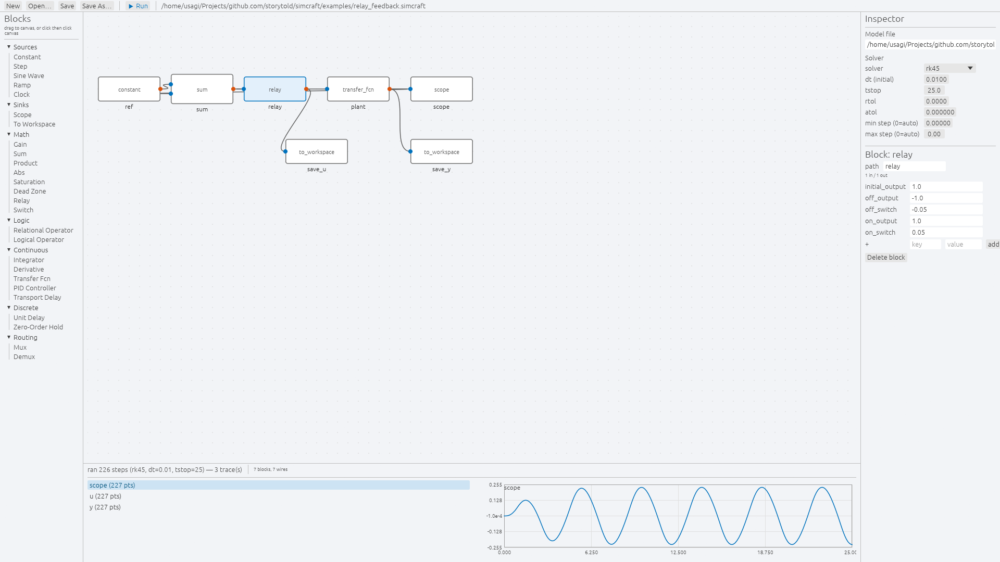
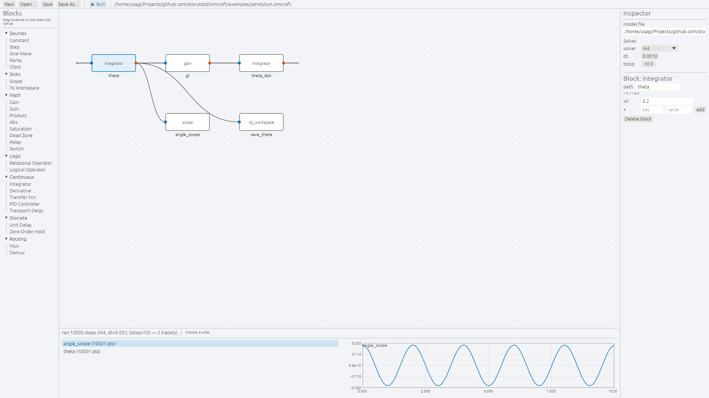

# SimCraft Studio User Guide

SimCraft Studio is the desktop graphical block diagram environment for modeling, simulating, and analyzing dynamic systems.



---

## Interface Layout

The Studio interface is organized into four intuitive regions:

```text
┌─────────────────┬──────────────────────────────────┬─────────────────┐
│                 │                                  │                 │
│  Block Palette  │         Diagram Canvas           │    Inspector    │
│                 │                                  │                 │
│  - Sources      │   ┌────────┐       ┌────────┐    │  - File State   │
│  - Sinks        │   │  Sine  │──────►│ Scope  │    │  - Solver Cfg   │
│  - Math         │   └────────┘       └────────┘    │  - Parameters   │
│  - Continuous   │                                  │                 │
│  - Discrete     │                                  │                 │
│                 │                                  │                 │
├─────────────────┴──────────────────────────────────┴─────────────────┤
│                        Trace Scopes & Sinks                          │
│                      [Scope]  [ToWorkspace]                          │
└──────────────────────────────────────────────────────────────────────┘
```

### 1. Left Panel: Block Palette
Lists all available blocks grouped into functional categories:
- **Sources**: `constant`, `step`, `sine`, `ramp`, `clock`.
- **Sinks**: `scope`, `to_workspace`.
- **Math**: `gain`, `sum`, `product`, `abs`, `saturation`, `dead_zone`, `relay`, `switch`.
- **Logic**: `relational`, `logical_operator`.
- **Continuous**: `integrator`, `derivative`, `transfer_fcn`, `pid`, `transport_delay`.
- **Discrete**: `unit_delay`, `zero_order_hold`.
- **Routing**: `mux`, `demux`.

### 2. Center: Diagram Canvas
The primary interactive modeling workspace:
- **Background**: Subtle 20px dot grid for alignment.
- **Blocks**: Rounded rectangular elements showing the block name, parameter summary, and input/output port pins.
- **Wires**: Cubic Hermite bezier curves with horizontal tangency, automatically routing cleanly between output and input ports.

### 3. Right Panel: Inspector
Shows context-sensitive properties based on selection:
- **Model Details**: Current file path, modification / dirty status, and quick save/reload buttons.
- **Solver Settings**: Solver selection (`rk45`, `rk4`, `euler`), time step $\Delta t$, stop time $t_{\text{stop}}$, and RK45 tolerances (`rtol`, `atol`).
- **Block Inspector**: When a block is selected, displays editable parameters (e.g. gain values, initial conditions, transfer function polynomials).

### 4. Bottom Dock: Trace Scopes & Plotter
Displays output signals from `Scope` and `To Workspace` blocks after a simulation run:
- Multi-channel colored line plots.
- Automatic axis scaling with high-precision time and amplitude bounds.
- Tabbed navigation across multiple scopes.



---

## Canvas Interactions & Gestures

| Action | Gesture / Shortcut | Description |
| --- | --- | --- |
| **Add Block** | Click palette item, then click canvas | Places block at mouse position. Hold `Shift` to place multiple copies. |
| **Move Block** | Click and drag block center | Moves block across the canvas with 10px grid snapping. |
| **Connect Wire** | Click-drag from output port $\to$ input port | Drops a bezier wire between the ports. Occupied destination inputs are replaced. |
| **Select** | Left-click block or wire | Highlights the element and opens its settings in the Inspector. |
| **Quick Edit** | Double-click block | Opens a floating quick-parameter edit dialog directly over the block. |
| **Delete** | `Delete` or `Backspace` | Removes the currently selected block or wire. |
| **Cancel** | `Escape` | Cancels an in-progress wire connection or placement action. |
| **Run Simulation** | `Run` button in header | Compiles graph, runs ODE solver, and refreshes scopes. |

---

## Command-Line Automation

SimCraft Studio supports command-line arguments for automated verification, batch testing, and documentation generation:

```bash
simcraft-studio [model.simcraft] [--run] [--select <name>] [--screenshot <path>]
```

### Options

- **`model.simcraft`**: Open the specified model file immediately on startup.
- **`--run`**: Automatically run the simulation once the model is loaded.
- **`--select <name>`**: Select block `<name>` on launch and focus it in the Inspector.
- **`--screenshot <path>`**: Render the window (fullscreen mode), capture the frame buffer to `<path>` (PNG format), and cleanly exit.

### Automated Documentation Screenshots
Studio powers the project's automated visual documentation via `packaging/screenshots.sh`:

```bash
# Capture relay feedback model with relay block focused
cargo run --bin simcraft-studio -- \
  examples/relay_feedback.simcraft \
  --run \
  --select relay \
  --screenshot docs/screenshots/studio_relay_feedback.png

# Capture nonlinear pendulum model with integrator focused
cargo run --bin simcraft-studio -- \
  examples/pendulum.simcraft \
  --run \
  --select theta \
  --screenshot docs/screenshots/studio_pendulum.png
```
